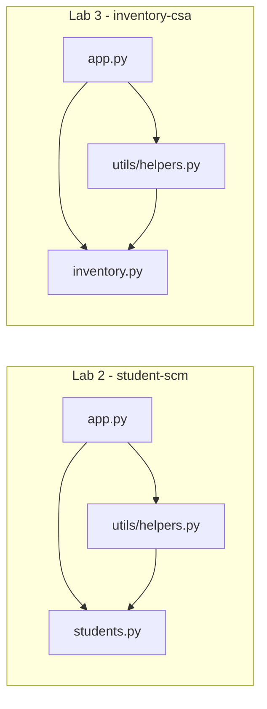
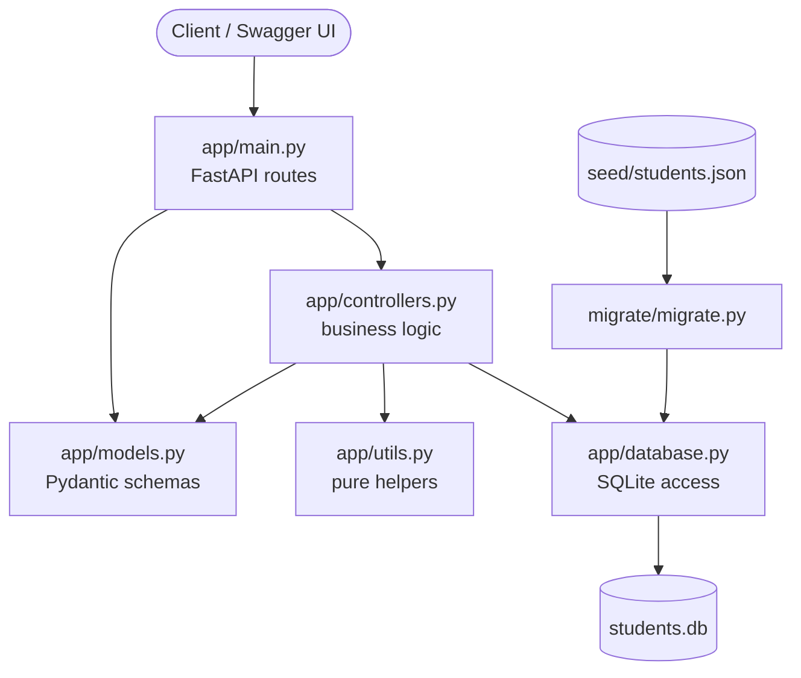
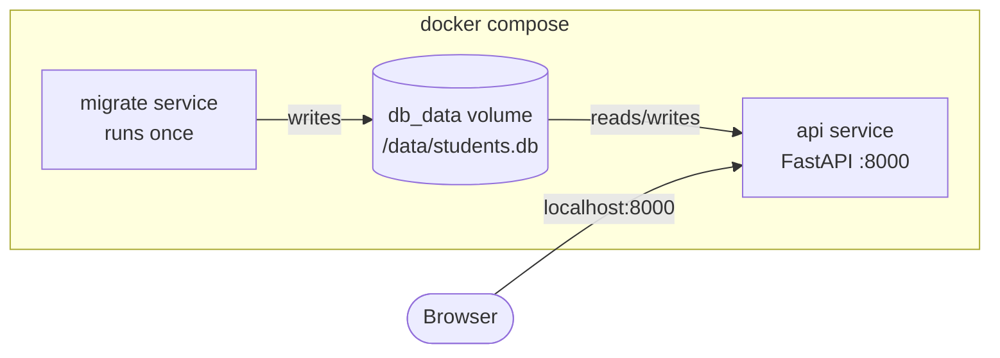

# Reverse Engineering of Lab 2 / Lab 3 Code

## 1. Inventory of the existing code

### Lab 2 - student-scm (v1.1)
| Module | Classes / functions | Responsibility |
|---|---|---|
| `students.py` | `Student`, `StudentRegistry` (`add`, `all`, `average`, `median`), `_validate_name`, `_validate_score` | Data + validation + statistics |
| `utils/helpers.py` | `highest_score`, `lowest_score`, `grade_for`, `rank_students`, `GRADE_BANDS` | Helper logic |
| `app.py` | `print_report`, `main` | Presentation (console) + demo data |

### Lab 3 - inventory-csa (v1.0)
| Module | Classes / functions | Responsibility |
|---|---|---|
| `inventory.py` | `Item`, `inventory` list | Data + validation |
| `utils/helpers.py` | `item_value`, `total_stock_value`, `highest_stock_item`, `lowest_stock_item`, `low_stock_items` | Calculations |
| `app.py` | `print_report`, `_name`, `main` | Presentation |

## 2. Dependency diagram (existing system)

## 3. Coupling and code smells found
- **Mixed responsibilities:** `students.py` holds the data model, the default demo data, validation and statistics in one file (low cohesion).
- **Presentation tied to data:** `app.py` hard-codes demo data via `registry.add(...)`, so the console UI cannot be reused by another front end.
- **Hard-coded data source:** records live in Python source; changing data means changing code. No persistence.
- **Duplicated logic:** both labs repeat the same patterns (validation, highest/lowest, report formatting).
- **Helpers depend on the data module** (`helpers -> students`), so pure utility code is coupled to the model.
- **No separation between logic and I/O:** formatting and calculation sit together in `print_report`.
- **Global mutable state:** `default_registry` is a module-level singleton shared by importers.

## 4. Improvement plan (implemented in this repo)
| Smell | Fix |
|---|---|
| Mixed responsibilities | Split into `models.py`, `controllers.py`, `utils.py`, `database.py`, `main.py` |
| Hard-coded data | Migrate JSON data to SQLite (`migrate/migrate.py`) |
| Console-only access | Expose RESTful endpoints with FastAPI |
| Duplicated logic (DRY) | One `_to_out()` converter, one `compute_stats()`, one `GRADE_BANDS` |
| Weak typing | Type hints everywhere, Pydantic validation |
| Hard to deploy | Dockerfiles + `docker-compose.yml` |

## 5. Dependency diagram (re-engineered system)

## 6. Container architecture

